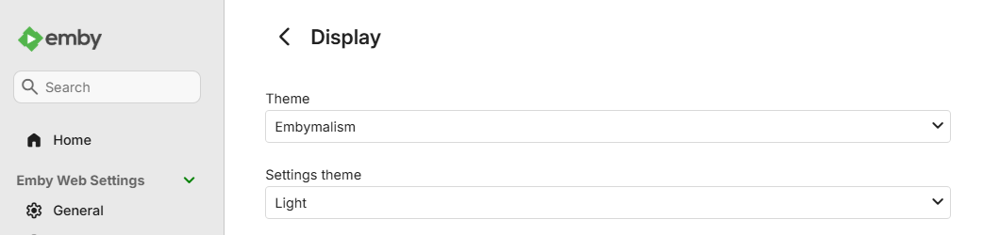

# Emby Look & Feel

**[English](#english) · [Español](#español)**

A modern look and richer title pages for **Emby running in Docker on TrueNAS SCALE**, installed and kept installed by one script: the [Embymalism](https://github.com/v1rusnl/Embymalism) theme plus the community addons from [Embymalism](https://github.com/v1rusnl/Embymalism), [EmbySpotlight](https://github.com/v1rusnl/EmbySpotlight) and [EmbyReviews](https://github.com/v1rusnl/EmbyReviews) — ratings, Oscar/Emmy awards, reviews, where to watch, a home Spotlight — with backup, rollback and an optional nginx layer that keeps API keys out of the browser.

Un look moderno y fichas más completas para **Emby en Docker sobre TrueNAS SCALE**, instalados y mantenidos por un solo script: el tema [Embymalism](https://github.com/v1rusnl/Embymalism) más los addons comunitarios de [Embymalism](https://github.com/v1rusnl/Embymalism), [EmbySpotlight](https://github.com/v1rusnl/EmbySpotlight) y [EmbyReviews](https://github.com/v1rusnl/EmbyReviews) — ratings, premios Oscar/Emmy, reseñas, dónde verlo, un Spotlight en el inicio — con backup, rollback y una capa nginx opcional que mantiene las API keys fuera del navegador.


<sub>*Sintel* © Blender Foundation | [durian.blender.org](https://durian.blender.org/), [CC BY 3.0](https://creativecommons.org/licenses/by/3.0/).</sub>

---

# English

- [What you get](#what-you-get) · [Quick start](#quick-start) · [After an Emby update](#after-an-emby-update)
- [Why this exists](#why-this-exists)
- [Before you run this](#before-you-run-this)
- [What it installs](#what-it-installs)
- [Requirements](#requirements)
- [Usage](#usage) · [Quick install](#quick-install-one-command) · [Configuration file](#configuration-file) · [First run](#first-run--credentials-wizard)
- [Execution modes and flags](#execution-modes-and-flags)
- [What happens, step by step](#what-happens-step-by-step)
- [Directory layout](#directory-layout)
- [Rollback, reapply, watchdog](#rollback-reapply-watchdog)
- [Exit codes](#exit-codes)
- [Security model](#security-model)
- [Reverse proxy (nginx): CORS proxy and API proxy](#reverse-proxy-nginx-cors-proxy-and-api-proxy)
- [Update detection](#update-detection)
- [Compatibility](#compatibility)
- [Operational contract](#operational-contract)
- [Addon details](#addon-details)
- [Known limitations](#known-limitations)
- [Tests](#tests) · [Contributing](#contributing) · [License](#license)

Related documents: [docs/ARCHITECTURE.md](docs/ARCHITECTURE.md) (design rationale), [SECURITY.md](SECURITY.md) and [docs/SECURITY-LAYERS.md](docs/SECURITY-LAYERS.md) (security, layer by layer), [docs/EMBY-API.md](docs/EMBY-API.md) (the Emby API as the add-ons use it), [deploy/README.md](deploy/README.md) (SSH helpers and nginx files), [tests/README.md](tests/README.md), [CHANGELOG.md](CHANGELOG.md).

## What you get

- **Embymalism as a real theme.** It shows up in Emby's own **Theme** selector next to Dark and Blue Radiance, and becomes the default for everyone (a default theme needs no Emby Premiere). The admin pages keep their own *Settings theme*, so they stay readable — installed the usual way, as Branding custom CSS, Embymalism turns them into black text on a black background. See [Embymalism as a Theme entry](#embymalism-as-a-theme-entry-settings-theme-untouched).
- **Richer title pages**, configured and ready: IMDb, Rotten Tomatoes, Metacritic, Trakt, Letterboxd and more ratings; Oscar/Emmy wins; TMDB reviews in your language; where to watch in your country (with a UI in English or Spanish instead of upstream's German); a Spotlight carousel on the home screen.
- **It survives Emby updates.** An app update recreates the container and wipes all of this; the [watchdog](#after-an-emby-update) puts it back on its own, and the installer picks the stylesheet made for *your* Emby version.
- **No API keys in the browser, shared ratings cache** (optional nginx layer): keys stay server-side and every rating is fetched once for all users and devices.
- **Safe to run and to undo**: dry run, backup before every change, byte-for-byte verification, one-command rollback.

## Quick start

1. On the TrueNAS host, download the script somewhere persistent and run it (it asks only for what it cannot detect, and your Emby and TMDB API keys on the first run):
   ```bash
   curl -fsSL https://raw.githubusercontent.com/hnacimiento/emby-look-and-feel/main/install-emby-custom.sh \
     -o install-emby-custom.sh && chmod +x install-emby-custom.sh && ./install-emby-custom.sh
   ```
2. Open Emby in the browser and reload with **Ctrl+Shift+R**.
3. Optional: put your values (region, languages, proxies) in a [configuration file](#configuration-file), and schedule the [watchdog](#after-an-emby-update).

Try it first without touching anything: `./install-emby-custom.sh --dry-run`.

## After an Emby update

Updating the Emby app (or changing its container settings) recreates the container, which brings back Emby's stock files: the theme and the addons disappear. Either re-run `./install-emby-custom.sh`, or let the watchdog do it — schedule it every 15 minutes (TrueNAS: System Settings → Advanced → Cron Jobs; the installer prints this line at the end with your paths):

```bash
/mnt/toolbox/scripts/emby-reapply-watchdog.sh --container ix-emby-emby-1 \
    --custom /mnt/toolbox/configs/emby/custom --installer /mnt/toolbox/scripts/install-emby-custom.sh
```

It reapplies what is already staged when Emby's version is the same, and re-runs the installer when it changed. Then reload the browser with Ctrl+Shift+R (and, with the nginx layer, run `deploy/nginx/purge-assets.sh`).

## Why this exists

The community addons that give Emby a modern look and richer metadata (Embymalism, EmbySpotlight, EmbyReviews) all require hand-editing files inside the container, Embymalism's own install path (Branding custom CSS) breaks the admin pages, and every Emby update undoes the work. This script makes them installable on Emby in Docker on TrueNAS SCALE with the discipline you want for anything that mutates a media server you use daily: a backup before every mutation, a verified rollback path, no secrets in logs or process listings, safe re-runs, and an honest account of what is still a known gap. It also translates `emby-elsewhere.js`'s German UI into English or Spanish, phrase by phrase.

It runs on a single home Emby setup — Docker on TrueNAS SCALE — and is shared as-is, including the parts of [docs/ARCHITECTURE.md](docs/ARCHITECTURE.md) that describe real bugs found and fixed during development.

> **Disclaimer.** This is an independent, unofficial community project: it is not affiliated with, endorsed by, or supported by Emby, or by the maintainers of Embymalism/EmbySpotlight/EmbyReviews or of TMDB/MDBList/Kinopoisk. It is free software, provided as-is, with no support guarantee of any kind. The backup, rollback and verification steps described throughout this README are the safety net this script builds for itself — not a promise that nothing will ever go wrong on your setup. You are responsible for reading [Before you run this](#before-you-run-this), testing against your own environment, and keeping your own backups before relying on it. To the extent permitted by law, use is entirely at your own risk; neither this project nor its contributors are liable for any damage, data loss, service disruption, or account/API issues that result from using it — see [License](#license) (MIT, "AS IS", no warranty).

## Before you run this

**What it modifies:**

```
HOST (inside the detected /config path)
├── secrets/api.env          — created once, holds your API keys
└── custom/                  — staged files, backups, logs, generated scripts

CONTAINER
├── /system/dashboard-ui/*.js                          — the 6 addon files
├── /system/dashboard-ui/index.html                    — gets <script> tags added
├── /system/dashboard-ui/modules/skinmanager.js        — one theme entry inserted
└── /system/dashboard-ui/modules/themes/embymalism/theme.css — Embymalism's CSS, as a theme

EMBY API
└── Branding CustomCss — replaced (normally emptied)
```

**What it never touches:** your media library, Emby's database, any other container; it never restarts or recreates the container.

**The one destructive step:** the script **replaces** Emby's entire `CustomCss` field — normally with an *empty* value, because Embymalism is installed as an entry of the **Theme** selector instead (see [Embymalism as a Theme entry](#embymalism-as-a-theme-entry-settings-theme-untouched)), and only as a fallback with the CSS content itself. Any other custom CSS you had in Emby is discarded from the live config, not merged. It is recoverable (`rollback-<timestamp>.sh` restores the exact previous value), but back it up yourself if you care about it. Interactive mode asks for confirmation right before this step (answering no skips only the CSS step and the run ends `DEGRADED`/exit `2`); `--silent` never asks.

The CSS is served from Emby's own `dashboard-ui` folder, so Emby never needs GitHub reachable when the web UI loads — only at install time. The stylesheet itself still pulls a Google Fonts `@import` and a couple of imgur-hosted images (upstream's dependencies).

**Know before the first run:** which container you are pointing at (the detection step lists candidates, you confirm); that the CustomCss replacement will happen; your Emby version (see [Compatibility](#compatibility)); that addons are fetched from upstream `main` on every run unless pinned (see [Update detection](#update-detection)).

## What it installs

| File | Source | Gets edited? |
|---|---|---|
| `emby-elsewhere.js` | [Embymalism/Addons](https://github.com/v1rusnl/Embymalism) | ✅ TMDB key (or placeholder), region, provider filters, CORS proxy, UI translated German→English/Spanish (`ELSEWHERE_UI_LANGUAGE`) |
| `emby-linklogos.js` | [Embymalism/Addons](https://github.com/v1rusnl/Embymalism) | – |
| `emby-media-ratings.js` | [Embymalism/Addons](https://github.com/v1rusnl/Embymalism) | – |
| `emby-ratings.js` | [Embymalism/Addons](https://github.com/v1rusnl/Embymalism) | ✅ TMDB/MDBList/Kinopoisk/OMDb keys (or placeholder) + rating providers + awards + cache + proxies |
| `Spotlight.js` | [EmbySpotlight](https://github.com/v1rusnl/EmbySpotlight) | ✅ keys (or placeholder) + full configuration (29 settings) |
| `Reviews.js` | [EmbyReviews](https://github.com/v1rusnl/EmbyReviews) | ✅ language/limits, TMDB key only if already declared upstream |
| `Embymalism.css` | [Embymalism](https://github.com/v1rusnl/Embymalism) | – (the one made for your Emby version; installed as a theme: `modules/themes/embymalism/theme.css` + one entry in `modules/skinmanager.js`) |
| `spotlight-items.txt` | [EmbySpotlight](https://github.com/v1rusnl/EmbySpotlight) | – (upstream's comment-only template) |
| `ratings-data.json` | generated | – (`{}`, or your own file via `RATINGS_DATA_FILE`) |

All six JS files are copied into the container's `dashboard-ui` folder and referenced with a `<script>` tag injected into `index.html` (idempotent — reinstalling never duplicates them). Each tag carries `?v=<first 12 hex of the file's SHA256>`, so after an install neither browsers nor a caching reverse proxy keep serving the previous version. The CSS becomes an entry named **Embymalism** in Emby's **Theme** selector (Preferences → Display → Theme), not Branding `CustomCss`. With the API proxy configured, the third-party keys never reach the browser (see [API proxy](#api-proxy-shared-ratings-cache--third-party-keys-out-of-the-browser)).

## Requirements

**On the host (TrueNAS SCALE):** `bash`, `docker`, `curl`, `grep`, `sed`, `awk`, `sha256sum`, `wc`, `tar`, `tail`, `truncate`, `flock` — all standard. Optional: `node` (syntax-check of the JS files), `jq` (exact verification of the Branding value and manifest sanity check).

**Nothing is hardcoded:** the container is chosen from `docker ps -a` (names/images containing "emby"); the data path is the chosen container's live `/config` mount, checked writable before anything else; the Emby URL is probed on the published `8096/tcp` port and asked for otherwise (if the container is on a macvlan/ipvlan network the host cannot reach its IP — a Docker limitation — and the script says so: give a URL through your reverse proxy, e.g. `EMBY_URL="https://emby.example.com"`); Emby's version is read and compared with the tested one (warns, never blocks). Container and URL are remembered in `.emby-installer-state` next to the script — or set once in the [configuration file](#configuration-file).

## Usage

### Quick install (one command)

Download the script onto the TrueNAS host and run it with whatever options you want:

```bash
curl -fsSL https://raw.githubusercontent.com/hnacimiento/emby-look-and-feel/main/install-emby-custom.sh \
  -o install-emby-custom.sh && chmod +x install-emby-custom.sh && ./install-emby-custom.sh
```

Fully unattended, once a config file or the flags provide container and URL:

```bash
./install-emby-custom.sh --silent --container=ix-emby-emby-1 --emby-url=http://192.168.1.10:8096
```

Download-then-run rather than `curl | bash` on purpose: the script keeps its state file and the portable backup **next to itself**, and the interactive wizard reads from your terminal — neither works from a pipe. Keep the file where you want those artifacts to live (e.g. `/mnt/toolbox/scripts/`). Check what you downloaded with `sha256sum install-emby-custom.sh` against the published checksum if you like.

### Configuration file

Everything specific to *your* deployment or taste lives outside the script, in `install-emby-custom.conf` next to it (or wherever `--config=PATH` points):

```bash
cp install-emby-custom.conf.example install-emby-custom.conf   # then edit it
./install-emby-custom.sh --print-config                        # shows the effective values, touches nothing
```

- Plain `KEY="value"` lines; the script **parses** the file (never `source`s it), accepts only the documented keys and validates every value by type — a typo or a `$(...)` in there is an error, not a silent default.
- Precedence: command-line flag > config file > built-in default. `EMBY_CONTAINER`/`EMBY_URL` can live there instead of on every command line.
- Keys are grouped by addon: theme (`CSS_PIN_REF`, `CSS_AUTO_MATCH_EMBY_VERSION`, `THEME_SET_AS_DEFAULT`), Elsewhere (region, UI language, provider filters), Reviews (languages, limits), Spotlight/ratings settings (including `RATINGS_ENABLE_AWARDS`, `RATINGS_ENABLE_CUSTOM_RATINGS`, `RATINGS_DATA_FILE`), backup retention, and the optional nginx proxies (`CORS_PROXY_URL`, `API_PROXY_URL`, `API_PROXY_RESOLVE_IP`).
- **API keys never go in it** — they stay in `secrets/api.env` inside the Emby data path. The config file is gitignored; the tracked template is [install-emby-custom.conf.example](install-emby-custom.conf.example).

### First run — credentials wizard

With no `secrets/api.env` yet, the script asks for **EMBY_API_KEY** (Emby → Dashboard → API Keys, required), **TMDB_API_KEY** (a v3 API key from [themoviedb.org](https://www.themoviedb.org/settings/api), required — not the v4 read token), **MDBLIST_API_KEY**, **KINOPOISK_API_KEY** and **OMDB_API_KEY** (optional; the OMDb one enables the Oscar/Emmy awards row of `emby-ratings.js`, free key at [omdbapi.com](https://www.omdbapi.com/apikey.aspx)). An already existing `secrets/api.env` can get `OMDB_API_KEY='...'` added by hand at any time. Keys are typed with echo off, never printed or logged, saved with `chmod 600`, and the two required ones are live-validated against TMDB and Emby before anything is downloaded. Cancelling the wizard exits cleanly with nothing written. On later runs the file is loaded (owner and permissions checked first) and the wizard is skipped.

## Execution modes and flags

| Mode | Command | For |
|---|---|---|
| **Interactive** (default) | `./install-emby-custom.sh` | Anyone — asks only what cannot be figured out automatically. |
| **Discovery-only** | `--discover-only` | Runs just the detection phase, saves container/path/URL to `.emby-installer-state`, exits. Nothing installed, no credentials touched. |
| **Silent** | `--silent [--container=NAME --emby-url=URL]` | Cron/pipelines. **Never** calls `read`; any missing piece fails immediately naming it. Container/URL come from the flags, the config file or the state file. |

Flags (all optional, combinable):

- `--container=NAME`, `--emby-url=URL` — skip detection for that item.
- `--config=PATH`, `--print-config` — see [Configuration file](#configuration-file).
- `--dry-run` — everything up to and including the addon edits and the `index.html`/`skinmanager.js` staging, then stop **before** backup/install. Nothing in the container or Emby changes.
- `--status` — compare the container (addons, `index.html`, `skinmanager.js`, `theme.css`, `spotlight-items.txt`, `ratings-data.json`, Branding CustomCss, container id, Emby version) with the last successful install, and report whether the optional NativeSpotlight plugin is present; exit `0` if identical, `1` on drift.
- `--check-updates` — download and compare hashes with the last successful install, report what changed upstream, exit without installing.
- `--uninstall` — run the newest generated `rollback-<timestamp>.sh` for the detected container.
- `--require-known-hashes` — abort (instead of warn) if a downloaded addon's SHA256 differs from the last successful install. Never blocks the first time an addon is seen.
- `--no-default-theme` — add Embymalism to the Theme selector but leave Dark as the default (same as `THEME_SET_AS_DEFAULT="0"`).
- `--version`, `-h`/`--help`.

Silent mode with no `secrets/api.env` yet also accepts `EMBY_API_KEY`/`TMDB_API_KEY` (and the optional keys) as **environment variables** to create it non-interactively — never as flags, so keys stay out of shell history and `ps`.

## What happens, step by step

```
PHASE 1/9  Dependencies        mandatory tools present, node/jq detected
PHASE 2/9  Auto-detection      pick/confirm container, derive /config and Emby URL,
                              check /config is writable, take the lock, read Emby's version
PHASE 3/9  Credentials         wizard (first run) or load secrets/api.env (owner/perms checked)
PHASE 4/9  Key validation      live check against TMDB and Emby (+ OMDb if configured, warn-only);
                              detect the optional NativeSpotlight server plugin
PHASE 5/9  Download            6 JS + CSS (the one made for your Emby version) + spotlight-items.txt,
                              SHA256 recorded and compared with the last install
PHASE 6/9  Edit                keys/placeholders + settings injected, API bases rewritten,
                              index.html <script> tags and the skinmanager.js theme entry staged,
                              API-proxy smoke test
PHASE 7/9  Backup              re-check the container is the same instance, save its current
                              files + Branding config, generate rollback/reapply scripts, portable .tgz
PHASE 8/9  Install             re-check identity, confirm the CSS replacement (interactive),
                              docker cp the files, POST the Branding value
PHASE 9/9  Verify              existence, size, SHA256 inside the container, key absence,
                              theme entry structure, Branding value
```

Backup happens **before** anything in the container is touched, and the rollback/reapply scripts exist on disk before the install step runs. A CSS `POST` failure is **non-critical** (warning, exit `2`, addons stay). Any other failure after the backup is **critical**: automatic in-process rollback to the pre-install state, temp files cleaned, non-zero exit. Two runs against the same container cannot race: a `flock` inside `/config` is held for the whole run.

"Installation completed" means every PHASE 9/9 check proved the files and the Branding value are byte-for-byte what was intended — it does not load the page. Hence the last step is always "reload with Ctrl+Shift+R and look".

## Directory layout

`/mnt/toolbox/configs/emby` below is an example — the real path is your container's `/config` mount. Two things live next to the script itself: `.emby-installer-state` and `emby-backup-<timestamp>.tgz`.

```
install-emby-custom.sh
install-emby-custom.conf               # your values (gitignored); template: install-emby-custom.conf.example
.emby-installer-state                  # remembered container + Emby URL, not a secret
emby-backup-<timestamp>.tgz            # portable copy of backups/<timestamp>/, same retention

/mnt/toolbox/configs/emby/             # <- wherever THIS container's /config points
├── secrets/api.env                    # chmod 600 — the only place keys live
├── .install-emby-custom.lock          # held for the run's duration
└── custom/
    ├── source/                        # pristine downloads, *.original suffix, for audit
    ├── dashboard-ui/                  # staged, edited copies actually installed
    │   ├── ratings-data.json          # {} or RATINGS_DATA_FILE
    │   └── modules/                   # patched skinmanager.js + themes/embymalism/theme.css
    ├── index.html.original            # Emby's own index.html, our <script> tags stripped
    ├── skinmanager.js.original        # Emby's own skinmanager.js, our theme entry stripped
    ├── backups/<timestamp>/           # pre-install snapshot + branding-before.json + installed hashes
    ├── config.json                    # non-secret settings, safe to share
    ├── known-source-sha256sums.txt    # last-seen upstream hash per addon (update detection)
    ├── install-<timestamp>.log · manifest-<timestamp>.json · SHA256SUMS-<timestamp>.txt
    ├── translation-<timestamp>.txt    # German -> English/Spanish phrases replaced in emby-elsewhere.js
    ├── rollback-<timestamp>.sh · reapply-<timestamp>.sh
    └── watchdog.log                   # if deploy/emby-reapply-watchdog.sh runs from cron
```

Only the last `BACKUP_RETENTION_COUNT` (5) installs are kept; older ones are pruned at the end of each successful install, never on a failure. No generated artifact ever contains a full API key value.

## Rollback, reapply, watchdog

```bash
# Undo an install: restores index.html, skinmanager.js and every addon from the
# backup taken just before installing, removes theme.css, restores the previous CustomCss.
bash /mnt/toolbox/configs/emby/custom/rollback-<timestamp>.sh      # or: ./install-emby-custom.sh --uninstall

# Redo an install without re-downloading: re-copies what is staged in custom/dashboard-ui/
# and re-applies the Branding step. Useful after an Emby container recreation wiped /system.
bash /mnt/toolbox/configs/emby/custom/reapply-<timestamp>.sh
```

Both read `secrets/api.env` at run time (the key is never embedded). `rollback-<timestamp>.sh` uses `backups/<timestamp>/` and falls back to the portable `.tgz` if that directory is gone. Neither assumes success: they report `SUCCESS`/`PARTIAL`/`FAILED` from what actually restored (hash-verified), and `reapply` takes its own lightweight backup first so a failure mid-reapply is reverted too.

**After an Emby upgrade, re-run the installer, not reapply.** The staged `index.html` and `skinmanager.js` are the old Emby version's files plus our additions; copying them over a newer Emby would replace its own files. `reapply` therefore refuses (exit `1`, nothing touched) when Emby's version differs from the one recorded at install time; `--force` overrides it if you know what you are doing. `--status` flags the same case.

**Watchdog:** [deploy/emby-reapply-watchdog.sh](deploy/emby-reapply-watchdog.sh) checks, from cron on the Emby host, that the addons, the `index.html` tags and the theme entry are still in the container. When a container recreation wiped them it runs the newest `reapply`; if Emby's version changed it runs the installer (`--installer`, a full `--silent` install that rebuilds everything for the new version), or without `--installer` only logs that a reinstall is needed. Scheduling: see [After an Emby update](#after-an-emby-update); `--dry-run` only reports.

## Exit codes

| Exit | Meaning |
|---|---|
| `0` | Full success. |
| `2` | Completed with a known, non-critical degradation: the CSS `POST` failed, or you declined it at the confirmation prompt. Addons and theme files installed fine. |
| `1` | Failed. **Includes a failed install whose automatic rollback fully succeeded** — check the log for `ROLLBACK_RESULT` (`SUCCESS`/`PARTIAL`/`FAILED`) to know the real state. |

`rollback-<timestamp>.sh`: `0` only if every resource was restored, `1` otherwise. `--status`: `0` no drift, `1` drift. `--check-updates`: `0` no upstream change, `1` something changed.

## Security model

Summary here; the full layer-by-layer walk-through is in [docs/SECURITY-LAYERS.md](docs/SECURITY-LAYERS.md) and the policy in [SECURITY.md](SECURITY.md).

- `secrets/api.env` (chmod 600) is the **only** persistent place any key lives. Its owner must match the running user; permissions are checked before reading.
- `EMBY_API_KEY` travels only as an `X-Emby-Token` header via a private `curl -K` config file (never a command-line argument), and is asserted absent from every installed file before and after install.
- With the [API proxy](#api-proxy-shared-ratings-cache--third-party-keys-out-of-the-browser), `TMDB_API_KEY`/`MDBLIST_API_KEY`/`KINOPOISK_API_KEY`/`OMDB_API_KEY` **never reach the browser**: the addons get a placeholder and nginx injects the real key server-side; the install aborts if a real key value is found in a staged addon. Without the proxy they are embedded in the JS, as upstream does.
- `Reviews.js` only gets `TMDB_API_KEY` if that declaration already exists upstream.
- The container is pinned by Docker `Id` and re-checked before backup and before install.
- The config file is parsed and validated, never sourced. Generated scripts get every value shell-quoted.

## Reverse proxy (nginx): CORS proxy and API proxy

Optional. Everything lives under [deploy/nginx/](deploy/nginx/), which mirrors the server layout (`etc/nginx/conf.d/`, `etc/nginx/snippets/`, `etc/fail2ban/...`); `nginx.conf` is never touched, and the Emby vhost only gets two `include` lines. Helpers: `install.sh` (upload, backup, `nginx -t`, reload, auto-revert), `render-keys.sh` (keys file without printing keys), `check.sh` (external test matrix), `purge-assets.sh` (drop cached `theme.css`/addon files after an install; `--all-web` for every `/web/` entry). See [deploy/README.md](deploy/README.md).

### CORS proxy for the addons

`Spotlight.js`, `emby-ratings.js` and `emby-elsewhere.js` have a `CORS_PROXY_URL` setting used only for the Rotten Tomatoes / AlloCiné scraping fallback and Elsewhere's "where to watch" deep links (sites without CORS). They append the full target URL: `https://emby.example.com/cors-proxy/https://www.rottentomatoes.com/m/inception`. `snippets/emby-cors-proxy.conf` is that `location`: **allow-list only** (`rottentomatoes.com`, `allocine.fr`, `themoviedb.org`), GET/HEAD, preflight answered locally, cookies stripped both ways, redirects rewritten back through the proxy, tolerant of nginx's `merge_slashes`, 24h disk cache with stale-while-revalidate. Set `CORS_PROXY_URL` in the config file (trailing slash) or leave it empty to disable the feature in the three addons.

### API proxy: shared ratings cache + third-party keys out of the browser

The rating badges load one by one because each is a separate browser call to MDBList, TMDB or Kinopoisk, cached by the addons only in `localStorage` per device. With `API_PROXY_URL` set, the installer rewrites the API bases in the four addons that call them to `<API_PROXY_URL>mdblist/`, `tmdb/`, `kinopoisk/`, `omdb/` and injects the placeholder `via-nginx-api-proxy` instead of the real keys. nginx (`conf.d/emby-api-cache.conf` + `snippets/emby-api-proxy.conf` + `emby-api-common.conf`, keys in `snippets/emby-api-keys.conf` chmod 600) strips the placeholder, adds the real key, and caches the JSON in its own zone for **all users and devices** (24h MDBList/TMDB, 7d Kinopoisk and OMDb, stale served instantly while refreshing; `omdb/` answers `503` without calling OMDb when nginx has no OMDb key, and caches OMDb's `401` — bad key or daily quota spent — for 10 minutes). Only GET/HEAD from Emby's own web (same-origin check by PCRE back-reference — nothing hardcoded — or a private-range origin), rate-limited per IP, one fixed upstream per location, and **authenticated against the Emby session**: nginx reflects the web client's `X-Emby-Token` into an `HttpOnly; Secure; SameSite=Strict; Path=/api-proxy/` cookie and validates it with `auth_request` against `/emby/System/Info` (LAN source IPs bypass it); requires nginx built with `--with-http_auth_request_module`. A fail2ban jail (`etc/fail2ban/`) bans repeated 401/403/405/429. The installer smoke-tests the chain first (warn-only). `API_PROXY_RESOLVE_IP` lets that smoke test reach the proxy by LAN IP when the NAS cannot hairpin to its own public address.

Net effect: the first person to open a title pays the API calls; everyone else, on any device, gets the cached answer in milliseconds, and no API key ever reaches a browser. `API_PROXY_URL=""` restores upstream behavior.

> Caches: the addon tags carry `?v=<hash>`, so a new addon version always gets a new URL. Two files keep theirs: `theme.css`, and `modules/skinmanager.js`, which Emby loads as `?v=<Emby version>` and whose content changes when the theme entry is added — e.g. a container recreated by an app update serves the stock file until you reinstall, and browsers or nginx (which caches static files for a day) may keep that copy. After such an install run `deploy/nginx/purge-assets.sh` on the proxy host; browsers that opened Emby in between need one hard reload (Ctrl+Shift+R).

## Update detection

Every download's SHA256 is compared with `known-source-sha256sums.txt` (hashes of the previous *successful* install). A change warns and proceeds; the baseline is only updated after PHASE 9/9 passes, so a run that downloads a broken addon and fails later leaves the last good hashes intact. `--require-known-hashes` makes a change a hard stop; `--check-updates` reports without installing; `CSS_PIN_REF` pins the stylesheet to a commit.

**The CSS follows your Emby version.** Upstream keeps one `Embymalism.css` per Emby release: `main` is for the newest Emby it supports (its first line says which, e.g. `Embymalism_4.10.1.0`) and older ones live in `Archive/Embymalism_<version>.css`. If `main` is for a different Emby than yours, the installer uses the archived CSS for your version, or keeps `main` with a warning if upstream has none (`CSS_AUTO_MATCH_EMBY_VERSION="0"` disables this; a `CSS_PIN_REF` is always respected). The manifest records `css_source` (`main`/`archive`/`pin`) and `css_emby_version`.

## Compatibility

| Emby version | Status |
|---|---|
| `4.10.1.0` | ✅ Tested (current) |
| `4.10.0.40` | ✅ Tested (earlier) |
| `4.9.5.0` | ✅ Tested (earlier) |
| Other `4.9.x`/`4.10.x` | ⚠️ Untested — likely fine; the version-mismatch warning tells you |
| `5.x` or newer | ⚠️ Untested — see [docs/ARCHITECTURE.md](docs/ARCHITECTURE.md#compatibility-and-future-emby-versions) |
| Non-Docker Emby | ❌ Unsupported — the detection model assumes a container |

If Emby changes `modules/skinmanager.js` so the theme anchor is not found, the script falls back to Branding `CustomCss` with a warning instead of failing.

## Operational contract

**Guaranteed:** it stops instead of guessing when a transformation cannot be applied; backup and rollback/reapply scripts exist before the install step; two runs cannot race the same container; `EMBY_API_KEY` never ends up in an installed file; a verification failure is treated like an install failure (full rollback, non-zero exit); recovery reports what it actually restored (hash-verified), never "done" regardless; the container is identified by `Id` and re-checked before mutating it.

**Not guaranteed:** that Emby's UI renders correctly (integrity, not health — reload and look); compatibility with untested Emby versions; stability of upstream `main`; protection against filesystem ACLs granting more access than the Unix bits show on `secrets/api.env`.

## Addon details


<sub>*Wings* (1927), public domain in the US.</sub>

### Embymalism as a Theme entry (Settings theme untouched)



Emby's web client runs **two themes at once**: the main theme and a separate **Settings theme** for its 50 admin/settings routes (`#!/dashboard`, `#!/users`, `#!/settings/*.html`, ...), which defaults to *Light*. Embymalism upstream expects both to be Dark and is installed as Branding `CustomCss`, which Emby loads globally — so admin pages end up with Light's black text on a forced black background. Instead, the script registers Embymalism as **one more entry in the Theme selector**, like Emby's own "Blue Radiance" or "Superman": `Embymalism.css` goes to `modules/themes/embymalism/theme.css`, one object is inserted into the hardcoded `AllThemes` array of `modules/skinmanager.js` right before the `Light` entry (Dark's stylesheets + ours last, `skipForSettingsthemes` so it never shows in the Settings-theme selector), and Branding `CustomCss` is emptied. The install verifies that stripping the entry gives back Emby's original file byte-for-byte.

By default it is also the **default main theme** (`THEME_SET_AS_DEFAULT="1"`: the single `||"dark"` literal at the end of Emby's `DefaultTheme` expression becomes `||"embymalism"`; Dark stays selectable). Everyone who never picked a theme gets Embymalism; users who chose another keep it (Emby stores that per user and per browser). With `--no-default-theme` users opt in under Preferences → Display → Theme — and, like every non-default Emby theme, that needs Emby Premiere; a default theme does not.

**Fallback:** if a future Emby changes `skinmanager.js` so the anchor is not found exactly once, the script does not patch it, records `theme.mode = "customcss"` in the manifest and uses Branding `CustomCss` as before. `skinmanager.js` is handled like `index.html`: pristine baseline kept and refreshed, restored by rollback, re-copied by reapply.

### emby-elsewhere.js — region, providers, translation

`ELSEWHERE_DEFAULT_REGION` (config file) replaces upstream's `US`. `ELSEWHERE_DEFAULT_PROVIDERS` / `ELSEWHERE_IGNORE_PROVIDERS` (`|`-separated in the config file) show only / hide specific providers; both empty = show everything. `CORS_PROXY_URL` is always set to the configured value. Upstream ships the UI strings in German; `ELSEWHERE_UI_LANGUAGE` picks what to do with them: `en` (default) or `es` translate them **phrase by phrase** (template placeholders intact), `de` leaves them untouched; `translation-<timestamp>.txt` lists what was replaced and a non-fatal audit warns if a known German phrase survived (upstream changed its text).

### Spotlight.js — full configuration

All 29 relevant `CONFIG` properties are set from `SPOTLIGHT_*` in the config file: limit, autoplay interval, vignette colors, play button color, video backdrop (autoplay, muted, volume, quality, wait-for-trailer), mobile video (forced `true`, upstream ships `false`), SponsorBlock, cache TTL, CORS proxy, and the per-provider rating toggles.

### emby-ratings.js — its own configuration

A separate addon with its own `CONFIG` (same keys, same per-provider toggles, `RATINGS_*` in the config file). Left unconfigured it shows no ratings at all, so the script configures it too.

Since upstream's 2026-09-30 rewrite it also has:

- **Awards** (`RATINGS_ENABLE_AWARDS`): Oscar and Emmy wins, from **OMDb**. They only show with `OMDB_API_KEY` in `secrets/api.env` (with the API proxy, also in nginx: `render-keys.sh`); without a key the setting is left empty and no awards row appears. Golden Globes, BAFTA, Razzies and the festival wins of earlier versions were dropped upstream.
- **`enableCustomRatings`** (`RATINGS_ENABLE_CUSTOM_RATINGS`): master switch for the external ratings.
- **`ratings-data.json`**: the addon reads `/web/ratings-data.json` first and only calls the APIs for what is missing; when the file is absent it retries every 60 s per browser (a 404 each time). The installer installs `{}` (no 404s, same behavior) or your own JSON object via `RATINGS_DATA_FILE` (keys `<movie|tv>_<tmdbId>`; upstream does not document the format further).
- **Optional NativeSpotlight server plugin**: the addon asks `/emby/NativeSpotlight/*`; with the plugin, ratings and awards are resolved server-side and its settings override the `enable*` switches. Upstream does not publish it, so the installer only detects it and reports it (summary, manifest, `--status`).

Settings that a given addon version does not have are skipped with a warning instead of failing, so an older or newer upstream file still installs.

### Reviews.js

`REVIEWS_PRIMARY_LANGUAGE`, `REVIEWS_SECONDARY_LANGUAGE`, `REVIEWS_MAX_REVIEWS`, `REVIEWS_PREVIEW_LENGTH`, `REVIEWS_EXPANDED_BY_DEFAULT`, `REVIEWS_SHOW_LANGUAGE_FLAGS`. `TMDB_API_KEY` is injected only if the declaration already exists upstream.

## Known limitations

- Each addon is edited in whatever format its upstream author chose ([docs/ARCHITECTURE.md](docs/ARCHITECTURE.md#addon-injection-mechanisms)); a format change upstream makes the script fail loudly naming the missing declaration — never a silent guess.
- The German→English/Spanish phrase list is a fixed set; the post-edit audit warns if upstream changed its text.
- The API proxy's session check needs nginx built with `--with-http_auth_request_module`; without it, remove the `auth_request` line and only the (soft) Referer/Origin gate remains — see [docs/SECURITY-LAYERS.md](docs/SECURITY-LAYERS.md).
- Warming the ratings cache for the whole library ahead of time is not implemented.
- `ratings-data.json` is only installed (empty or your file), not generated; the NativeSpotlight server plugin is only detected, not installed.
- Spotlight.js reads an optional curated list at `/web/spotlight-items.txt` (one Emby item ID per line, `#` for comments). The installer downloads and installs upstream's comment-only template by default, so there is no 404 out of the box: leave it as-is for the normal random selection, or add item IDs to curate the Spotlight. (If you delete it, the request 404s and Spotlight falls back to random — also harmless.)
- Designed for Emby in Docker on TrueNAS SCALE; other setups are out of scope.

## Tests

```bash
./tests/run_tests.sh
```

Pure bash, no extra dependencies. Unit tests extract the **real** functions from the script (escaping, injection helpers, CSS embedding, theme injection, API-proxy rewrite including OMDb, config loader, CSS version detection, optional settings, `ratings-data.json` validation); integration tests generate the real `rollback`/`reapply` scripts and run them against `docker`/`curl` stubs, exercising the failure state machine and the reapply Emby-version guard. CI ([.github/workflows/ci.yml](.github/workflows/ci.yml)) runs syntax checks, shellcheck, the suite, and a guard against deployment-specific data in tracked files. Details: [tests/README.md](tests/README.md).

## Contributing

Issues and pull requests are welcome — especially reports of this working (or not) on newer Emby versions with the specific error, and end-to-end tests of the install flow (today the suite covers the functions and the recovery scripts, not PHASE 1–9 end to end). Read [docs/ARCHITECTURE.md](docs/ARCHITECTURE.md) before changing the injection logic: most of what looks simplifiable was tried and reverted for a documented reason. Code, comments and user-facing messages of the script are in English; the documentation is bilingual.

## Acknowledgments

All credit for the actual features goes to [v1rusnl](https://github.com/v1rusnl) for [Embymalism](https://github.com/v1rusnl/Embymalism), [EmbySpotlight](https://github.com/v1rusnl/EmbySpotlight) and [EmbyReviews](https://github.com/v1rusnl/EmbyReviews). This project only automates installing them correctly — and keeping them installed — on Emby in Docker on TrueNAS SCALE.

## License

[MIT](LICENSE).

---

# Español

- [Qué obtenés](#qué-obtenés) · [Inicio rápido](#inicio-rápido) · [Después de actualizar Emby](#después-de-actualizar-emby)
- [Por qué existe](#por-qué-existe)
- [Antes de correrlo](#antes-de-correrlo)
- [Qué instala](#qué-instala)
- [Requisitos](#requisitos)
- [Uso](#uso) · [Instalación rápida](#instalación-rápida-un-comando) · [Archivo de configuración](#archivo-de-configuración) · [Primera corrida](#primera-corrida--wizard-de-credenciales)
- [Modos de ejecución y flags](#modos-de-ejecución-y-flags)
- [Qué pasa, paso a paso](#qué-pasa-paso-a-paso)
- [Estructura de directorios](#estructura-de-directorios)
- [Rollback, reapply, watchdog](#rollback-reapply-watchdog-1)
- [Códigos de salida](#códigos-de-salida)
- [Modelo de seguridad](#modelo-de-seguridad)
- [Reverse proxy (nginx): CORS proxy y API proxy](#reverse-proxy-nginx-cors-proxy-y-api-proxy)
- [Detección de actualizaciones](#detección-de-actualizaciones)
- [Compatibilidad](#compatibilidad)
- [Contrato operativo](#contrato-operativo)
- [Detalle por addon](#detalle-por-addon)
- [Limitaciones conocidas](#limitaciones-conocidas)
- [Tests](#tests-1) · [Contribuir](#contribuir) · [Licencia](#licencia)

Documentos relacionados: [docs/ARCHITECTURE.md](docs/ARCHITECTURE.md) (razones de diseño), [SECURITY.md](SECURITY.md) y [docs/SECURITY-LAYERS.md](docs/SECURITY-LAYERS.md) (seguridad, capa por capa), [docs/EMBY-API.md](docs/EMBY-API.md) (la API de Emby como la usan los add-ons), [deploy/README.md](deploy/README.md) (helpers SSH y archivos de nginx), [tests/README.md](tests/README.md), [CHANGELOG.md](CHANGELOG.md).

## Qué obtenés

- **Embymalism como tema de verdad.** Aparece en el propio combo **Theme** de Emby, junto a Dark y Blue Radiance, y queda como tema por defecto para todos (un tema por defecto no requiere Emby Premiere). Las páginas de administración conservan su propio *Settings theme* y siguen legibles — instalado de la forma habitual, como CSS personalizado de Branding, Embymalism las deja con texto negro sobre fondo negro. Ver [Embymalism como entrada de Theme](#embymalism-como-entrada-del-combo-theme-settings-theme-intacto).
- **Fichas más completas**, configuradas y listas: ratings de IMDb, Rotten Tomatoes, Metacritic, Trakt, Letterboxd y más; Oscars/Emmys ganados; reseñas de TMDB en tu idioma; dónde verlo en tu país (con la interfaz en español o inglés en lugar del alemán de upstream); un carrusel Spotlight en el inicio.
- **Sobrevive a las actualizaciones de Emby.** Una actualización de la app recrea el container y borra todo esto; el [watchdog](#después-de-actualizar-emby) lo vuelve a poner solo, y el instalador elige la hoja de estilos hecha para *tu* versión de Emby.
- **Sin API keys en el navegador y con caché compartida de ratings** (capa nginx opcional): las keys quedan del lado servidor y cada rating se pide una sola vez para todos los usuarios y dispositivos.
- **Seguro de correr y de deshacer**: modo de prueba, backup antes de cada cambio, verificación byte a byte, rollback con un comando.

## Inicio rápido

1. En el host TrueNAS, bajá el script a un lugar persistente y corrélo (pregunta solo lo que no puede detectar, y tus API keys de Emby y TMDB la primera vez):
   ```bash
   curl -fsSL https://raw.githubusercontent.com/hnacimiento/emby-look-and-feel/main/install-emby-custom.sh \
     -o install-emby-custom.sh && chmod +x install-emby-custom.sh && ./install-emby-custom.sh
   ```
2. Abrí Emby en el navegador y recargá con **Ctrl+Shift+R**.
3. Opcional: poné tus valores (región, idiomas, proxies) en un [archivo de configuración](#archivo-de-configuración) y programá el [watchdog](#después-de-actualizar-emby).

Para probar sin tocar nada: `./install-emby-custom.sh --dry-run`.

## Después de actualizar Emby

Actualizar la app de Emby (o cambiar la configuración de su container) recrea el container, que vuelve a los archivos de fábrica de Emby: el tema y los addons desaparecen. Volvé a correr `./install-emby-custom.sh`, o dejá que lo haga el watchdog — programalo cada 15 minutos (TrueNAS: System Settings → Advanced → Cron Jobs; el instalador imprime esta línea al final con tus rutas):

```bash
/mnt/toolbox/scripts/emby-reapply-watchdog.sh --container ix-emby-emby-1 \
    --custom /mnt/toolbox/configs/emby/custom --installer /mnt/toolbox/scripts/install-emby-custom.sh
```

Si la versión de Emby es la misma, re-aplica lo ya preparado; si cambió, vuelve a correr el instalador. Después recargá el navegador con Ctrl+Shift+R (y, con la capa nginx, corré `deploy/nginx/purge-assets.sh`).

## Por qué existe

Los addons comunitarios que le dan a Emby una apariencia moderna y más metadatos (Embymalism, EmbySpotlight, EmbyReviews) exigen editar archivos a mano dentro del container, la forma de instalación propia de Embymalism (CSS personalizado de Branding) rompe las páginas de administración, y cada actualización de Emby deshace el trabajo. Este script los hace instalables en Emby en Docker sobre TrueNAS SCALE con la disciplina que querés para cualquier cosa que muta un servidor de medios que usás a diario: backup antes de cada mutación, rollback verificado, sin secretos en logs ni en listados de procesos, re-ejecuciones seguras y una lista honesta de lo que sigue siendo un hueco conocido. Además traduce al español o al inglés, frase por frase, la interfaz en alemán de `emby-elsewhere.js`.

Corre sobre una única instalación doméstica de Emby — Docker sobre TrueNAS SCALE — y se comparte tal cual, incluidas las partes de [docs/ARCHITECTURE.md](docs/ARCHITECTURE.md) que describen bugs reales encontrados y corregidos durante el desarrollo.

> **Descargo de responsabilidad.** Este es un proyecto de comunidad independiente y no oficial: no tiene afiliación, aval ni soporte de Emby, ni de los mantenedores de Embymalism/EmbySpotlight/EmbyReviews ni de TMDB/MDBList/Kinopoisk. Es software libre, se ofrece tal cual, sin ninguna garantía de soporte. Los pasos de backup, rollback y verificación descritos en este README son la red de seguridad que este script se da a sí mismo — no una promesa de que nunca vaya a salir nada mal en tu instalación. Sos responsable de leer [Antes de correrlo](#antes-de-correrlo), probarlo contra tu propio entorno y mantener tus propios backups antes de confiar en él. En la medida que lo permita la ley, el uso es enteramente bajo tu propio riesgo; ni este proyecto ni sus colaboradores se hacen responsables de ningún daño, pérdida de datos, interrupción del servicio o problema de cuenta/API que resulte de usarlo — ver [Licencia](#licencia) (MIT, "TAL CUAL", sin garantía).

## Antes de correrlo

**Qué modifica:**

```
HOST (dentro del /config detectado)
├── secrets/api.env          — se crea una vez, guarda tus API keys
└── custom/                  — archivos preparados, backups, logs, scripts generados

CONTAINER
├── /system/dashboard-ui/*.js                          — los 6 addons
├── /system/dashboard-ui/index.html                    — recibe los <script>
├── /system/dashboard-ui/modules/skinmanager.js        — una entrada de tema insertada
└── /system/dashboard-ui/modules/themes/embymalism/theme.css — el CSS de Embymalism, como tema

API DE EMBY
└── Branding CustomCss — reemplazado (normalmente vaciado)
```

**Qué no toca nunca:** tu biblioteca, la base de datos de Emby, otros containers; nunca reinicia ni recrea el container.

**El único paso destructivo:** el script **reemplaza** por completo el campo `CustomCss` de Emby — normalmente con un valor *vacío*, porque Embymalism se instala como entrada del combo **Theme** (ver [Embymalism como entrada de Theme](#embymalism-como-entrada-del-combo-theme-settings-theme-intacto)), y solo como fallback con el contenido del CSS. Cualquier otro CSS que tuvieras en Emby se descarta de la configuración viva, no se fusiona. Es recuperable (`rollback-<timestamp>.sh` repone el valor exacto anterior), pero hacé tu propio backup si te importa. El modo interactivo pide confirmación justo antes de ese paso (responder que no saltea solo el CSS y la corrida termina `DEGRADED`/exit `2`); `--silent` nunca pregunta.

El CSS se sirve desde la propia carpeta `dashboard-ui` de Emby, así que Emby no necesita llegar a GitHub al cargar la web — solo al instalar. La hoja de estilos en sí sigue trayendo un `@import` de Google Fonts y un par de imágenes de imgur (dependencias de upstream).

**Sabé antes de la primera corrida:** a qué container apuntás (la detección lista candidatos, vos confirmás); que el reemplazo del CustomCss va a ocurrir; tu versión de Emby (ver [Compatibilidad](#compatibilidad)); que los addons se bajan de la rama `main` de upstream en cada corrida salvo que los fijes (ver [Detección de actualizaciones](#detección-de-actualizaciones)).

## Qué instala

| Archivo | Origen | ¿Se edita? |
|---|---|---|
| `emby-elsewhere.js` | [Embymalism/Addons](https://github.com/v1rusnl/Embymalism) | ✅ key de TMDB (o placeholder), región, filtros de proveedores, CORS proxy, interfaz traducida alemán→inglés/español (`ELSEWHERE_UI_LANGUAGE`) |
| `emby-linklogos.js` | [Embymalism/Addons](https://github.com/v1rusnl/Embymalism) | – |
| `emby-media-ratings.js` | [Embymalism/Addons](https://github.com/v1rusnl/Embymalism) | – |
| `emby-ratings.js` | [Embymalism/Addons](https://github.com/v1rusnl/Embymalism) | ✅ keys de TMDB/MDBList/Kinopoisk/OMDb (o placeholder) + proveedores + premios + caché + proxies |
| `Spotlight.js` | [EmbySpotlight](https://github.com/v1rusnl/EmbySpotlight) | ✅ keys (o placeholder) + configuración completa (29 ajustes) |
| `Reviews.js` | [EmbyReviews](https://github.com/v1rusnl/EmbyReviews) | ✅ idioma/límites, key de TMDB solo si upstream ya la declara |
| `Embymalism.css` | [Embymalism](https://github.com/v1rusnl/Embymalism) | – (el hecho para tu versión de Emby; instalado como tema: `modules/themes/embymalism/theme.css` + una entrada en `modules/skinmanager.js`) |
| `spotlight-items.txt` | [EmbySpotlight](https://github.com/v1rusnl/EmbySpotlight) | – (la plantilla de upstream, solo comentarios) |
| `ratings-data.json` | generado | – (`{}`, o tu propio archivo vía `RATINGS_DATA_FILE`) |

Los seis JS se copian a `dashboard-ui` del container y se referencian con un `<script>` inyectado en `index.html` (idempotente — reinstalar nunca los duplica). Cada tag lleva `?v=<primeros 12 hex del SHA256 del archivo>`, así que después de instalar ni los navegadores ni un reverse proxy con caché siguen sirviendo la versión anterior. El CSS pasa a ser una entrada llamada **Embymalism** en el combo **Theme** de Emby (Preferencias → Display → Theme), no `CustomCss` de Branding. Con el API proxy configurado, las keys de terceros nunca llegan al navegador (ver [API proxy](#api-proxy-caché-compartida-de-ratings--keys-de-terceros-fuera-del-navegador)).

## Requisitos

**En el host (TrueNAS SCALE):** `bash`, `docker`, `curl`, `grep`, `sed`, `awk`, `sha256sum`, `wc`, `tar`, `tail`, `truncate`, `flock` — todo estándar. Opcionales: `node` (chequeo de sintaxis de los JS), `jq` (verificación exacta del valor de Branding y del manifest).

**Nada hardcodeado:** el container se elige de `docker ps -a` (nombres/imágenes con "emby"); la ruta de datos es el mount `/config` real del container elegido, verificado escribible antes de nada; la URL de Emby se prueba en el puerto publicado `8096/tcp` y si no, se pregunta (si el container está en una red macvlan/ipvlan el host no puede llegar a su IP — una limitación de Docker — y el script lo avisa: usá una URL a través de tu reverse proxy, p. ej. `EMBY_URL="https://emby.example.com"`); la versión de Emby se lee y compara con la probada (avisa, nunca bloquea). Container y URL se recuerdan en `.emby-installer-state` junto al script — o se fijan una vez en el [archivo de configuración](#archivo-de-configuración).

## Uso

### Instalación rápida (un comando)

Descargá el script en el TrueNAS y corrélo con las opciones que quieras:

```bash
curl -fsSL https://raw.githubusercontent.com/hnacimiento/emby-look-and-feel/main/install-emby-custom.sh \
  -o install-emby-custom.sh && chmod +x install-emby-custom.sh && ./install-emby-custom.sh
```

Totalmente desatendido, una vez que el archivo de configuración o las flags aportan container y URL:

```bash
./install-emby-custom.sh --silent --container=ix-emby-emby-1 --emby-url=http://192.168.1.10:8096
```

Descargar-y-ejecutar en vez de `curl | bash` a propósito: el script guarda su archivo de estado y el backup portátil **al lado de sí mismo**, y el wizard interactivo lee de tu terminal — nada de eso funciona desde un pipe. Dejalo donde quieras que vivan esos artefactos (p. ej. `/mnt/toolbox/scripts/`). Si querés, comprobá lo descargado con `sha256sum install-emby-custom.sh` contra el checksum publicado.

### Archivo de configuración

Todo lo específico de *tu* despliegue o gusto vive fuera del script, en `install-emby-custom.conf` al lado (o donde apunte `--config=PATH`):

```bash
cp install-emby-custom.conf.example install-emby-custom.conf   # y editalo
./install-emby-custom.sh --print-config                        # muestra los valores efectivos, no toca nada
```

- Líneas `KEY="valor"`; el script **parsea** el archivo (nunca lo "sourcea"), acepta solo las claves documentadas y valida cada valor por tipo — un error de tipeo o un `$(...)` ahí es un error, no un default silencioso.
- Precedencia: flag de línea de comando > archivo de configuración > default del script. `EMBY_CONTAINER`/`EMBY_URL` pueden vivir ahí en vez de en cada comando.
- Claves agrupadas por addon: tema (`CSS_PIN_REF`, `CSS_AUTO_MATCH_EMBY_VERSION`, `THEME_SET_AS_DEFAULT`), Elsewhere (región, idioma de la interfaz, filtros de proveedores), Reviews (idiomas, límites), ajustes de Spotlight/ratings (incluidos `RATINGS_ENABLE_AWARDS`, `RATINGS_ENABLE_CUSTOM_RATINGS`, `RATINGS_DATA_FILE`), retención de backups y los proxies nginx opcionales (`CORS_PROXY_URL`, `API_PROXY_URL`, `API_PROXY_RESOLVE_IP`).
- **Las API keys nunca van ahí** — quedan en `secrets/api.env` dentro de la ruta de datos de Emby. El archivo está gitignored; la plantilla versionada es [install-emby-custom.conf.example](install-emby-custom.conf.example).

### Primera corrida — wizard de credenciales

Sin `secrets/api.env` todavía, el script pide **EMBY_API_KEY** (Emby → Dashboard → API Keys, obligatoria), **TMDB_API_KEY** (una API key v3 de [themoviedb.org](https://www.themoviedb.org/settings/api), obligatoria — no el token de lectura v4), **MDBLIST_API_KEY**, **KINOPOISK_API_KEY** y **OMDB_API_KEY** (opcionales; la de OMDb habilita la fila de premios Oscar/Emmy de `emby-ratings.js`, key gratis en [omdbapi.com](https://www.omdbapi.com/apikey.aspx)). A un `secrets/api.env` existente se le puede agregar `OMDB_API_KEY='...'` a mano en cualquier momento. Se tipean sin eco, no se imprimen ni se loguean, se guardan con `chmod 600`, y las dos obligatorias se validan en vivo contra TMDB y Emby antes de descargar nada. Cancelar el wizard sale limpio sin escribir nada. En corridas posteriores el archivo se carga (dueño y permisos verificados) y el wizard se saltea.

## Modos de ejecución y flags

| Modo | Comando | Para |
|---|---|---|
| **Interactivo** (default) | `./install-emby-custom.sh` | Cualquiera — pregunta solo lo que no puede deducir. |
| **Solo detección** | `--discover-only` | Corre solo la fase de detección, guarda container/ruta/URL en `.emby-installer-state` y sale. No instala nada, no toca credenciales. |
| **Silencioso** | `--silent [--container=NOMBRE --emby-url=URL]` | Cron/pipelines. **Nunca** llama a `read`; cualquier dato faltante falla al instante diciendo cuál. Container/URL salen de las flags, del archivo de configuración o del archivo de estado. |

Flags (todas opcionales, combinables):

- `--container=NOMBRE`, `--emby-url=URL` — saltear la detección de ese dato.
- `--config=PATH`, `--print-config` — ver [Archivo de configuración](#archivo-de-configuración).
- `--dry-run` — todo hasta la edición de addons y la preparación de `index.html`/`skinmanager.js` inclusive, y para **antes** de backup/instalación. No cambia nada en el container ni en Emby.
- `--status` — compara el container (addons, `index.html`, `skinmanager.js`, `theme.css`, `spotlight-items.txt`, `ratings-data.json`, CustomCss de Branding, id del container, versión de Emby) con la última instalación exitosa, e informa si está el plugin opcional NativeSpotlight; exit `0` si es idéntico, `1` si hay diferencias.
- `--check-updates` — descarga y compara hashes con la última instalación exitosa, informa qué cambió en upstream y sale sin instalar.
- `--uninstall` — corre el `rollback-<timestamp>.sh` más reciente del container detectado.
- `--require-known-hashes` — abortar (en vez de avisar) si el SHA256 de un addon descargado difiere de la última instalación exitosa. Nunca bloquea la primera vez que se ve un addon.
- `--no-default-theme` — agregar Embymalism al combo Theme pero dejar Dark como default (igual que `THEME_SET_AS_DEFAULT="0"`).
- `--version`, `-h`/`--help`.

El modo silencioso sin `secrets/api.env` también acepta `EMBY_API_KEY`/`TMDB_API_KEY` (y las opcionales) como **variables de entorno** para crearlo sin interacción — nunca como flags, para que las keys no queden en el historial del shell ni en `ps`.

## Qué pasa, paso a paso

```
PHASE 1/9  Dependencias        herramientas obligatorias presentes, node/jq detectados
PHASE 2/9  Autodetección       elegir/confirmar container, derivar /config y URL de Emby,
                              verificar que /config es escribible, tomar el lock, leer la versión
PHASE 3/9  Credenciales        wizard (primera vez) o cargar secrets/api.env (dueño/permisos verificados)
PHASE 4/9  Validación de keys  chequeo en vivo contra TMDB y Emby (+ OMDb si está configurada, solo avisa);
                              detección del plugin de servidor opcional NativeSpotlight
PHASE 5/9  Descarga            6 JS + CSS (el hecho para tu versión de Emby) + spotlight-items.txt,
                              SHA256 registrado y comparado con la última instalación
PHASE 6/9  Edición             keys/placeholders + ajustes inyectados, bases de API reescritas,
                              <script> en index.html y entrada de tema en skinmanager.js preparados,
                              smoke test del API proxy
PHASE 7/9  Backup              re-verificar que el container es la misma instancia, guardar sus archivos
                              + config de Branding, generar rollback/reapply, .tgz portátil
PHASE 8/9  Instalación         re-verificar identidad, confirmar el reemplazo del CSS (interactivo),
                              docker cp de los archivos, POST del valor de Branding
PHASE 9/9  Verificación        existencia, tamaño, SHA256 dentro del container, ausencia de keys,
                              estructura de la entrada de tema, valor de Branding
```

El backup ocurre **antes** de tocar nada en el container, y los scripts de rollback/reapply existen en disco antes de instalar. Un fallo del `POST` del CSS es **no crítico** (aviso, exit `2`, los addons quedan). Cualquier otro fallo después del backup es **crítico**: rollback automático en el mismo proceso al estado previo, temporales limpiados, exit distinto de cero. Dos corridas contra el mismo container no pueden pisarse: un `flock` dentro de `/config` se mantiene toda la corrida.

"Instalación completada" significa que cada chequeo de PHASE 9/9 probó que los archivos y el valor de Branding son byte a byte lo previsto — no carga la página. Por eso el último paso siempre es "recargá con Ctrl+Shift+R y mirá".

## Estructura de directorios

`/mnt/toolbox/configs/emby` es un ejemplo — la ruta real es el mount `/config` de tu container. Dos cosas viven junto al script: `.emby-installer-state` y `emby-backup-<timestamp>.tgz`.

```
install-emby-custom.sh
install-emby-custom.conf               # tus valores (gitignored); plantilla: install-emby-custom.conf.example
.emby-installer-state                  # container + URL recordados, no es un secreto
emby-backup-<timestamp>.tgz            # copia portátil de backups/<timestamp>/, misma retención

/mnt/toolbox/configs/emby/             # <- donde apunte el /config de ESTE container
├── secrets/api.env                    # chmod 600 — el único lugar donde viven las keys
├── .install-emby-custom.lock          # mantenido durante toda la corrida
└── custom/
    ├── source/                        # descargas intactas, sufijo *.original, para auditar
    ├── dashboard-ui/                  # copias editadas que realmente se instalan
    │   ├── ratings-data.json          # {} o RATINGS_DATA_FILE
    │   └── modules/                   # skinmanager.js parcheado + themes/embymalism/theme.css
    ├── index.html.original            # el index.html de Emby sin nuestros <script>
    ├── skinmanager.js.original        # el skinmanager.js de Emby sin nuestra entrada
    ├── backups/<timestamp>/           # snapshot previo + branding-before.json + hashes instalados
    ├── config.json                    # ajustes no secretos, seguro de compartir
    ├── known-source-sha256sums.txt    # último hash visto por addon (detección de actualizaciones)
    ├── install-<timestamp>.log · manifest-<timestamp>.json · SHA256SUMS-<timestamp>.txt
    ├── translation-<timestamp>.txt    # frases alemán -> inglés/español reemplazadas en emby-elsewhere.js
    ├── rollback-<timestamp>.sh · reapply-<timestamp>.sh
    └── watchdog.log                   # si deploy/emby-reapply-watchdog.sh corre por cron
```

Solo se conservan las últimas `BACKUP_RETENTION_COUNT` (5) instalaciones; las más viejas se podan al final de cada instalación exitosa, nunca en un fallo. Ningún artefacto generado contiene una API key completa.

## Rollback, reapply, watchdog

```bash
# Deshacer una instalación: repone index.html, skinmanager.js y cada addon desde el backup
# tomado justo antes de instalar, elimina theme.css y restaura el CustomCss anterior.
bash /mnt/toolbox/configs/emby/custom/rollback-<timestamp>.sh      # o: ./install-emby-custom.sh --uninstall

# Rehacer una instalación sin volver a descargar: re-copia lo preparado en custom/dashboard-ui/
# y re-aplica el paso de Branding. Útil después de que una recreación del container borró /system.
bash /mnt/toolbox/configs/emby/custom/reapply-<timestamp>.sh
```

Ambos leen `secrets/api.env` al ejecutarse (la key nunca se embebe). `rollback-<timestamp>.sh` usa `backups/<timestamp>/` y cae al `.tgz` portátil si ese directorio ya no está. Ninguno asume éxito: informan `SUCCESS`/`PARTIAL`/`FAILED` según lo que realmente restauraron (verificado por hash), y `reapply` toma primero su propio backup liviano para poder revertir también un fallo a mitad de camino.

**Después de actualizar Emby, volvé a correr el instalador, no reapply.** El `index.html` y el `skinmanager.js` preparados son los archivos de la versión vieja de Emby más nuestros agregados; copiarlos sobre un Emby más nuevo reemplazaría sus propios archivos. Por eso `reapply` se niega (exit `1`, sin tocar nada) cuando la versión de Emby difiere de la registrada al instalar; `--force` lo fuerza si sabés lo que hacés. `--status` marca el mismo caso.

**Watchdog:** [deploy/emby-reapply-watchdog.sh](deploy/emby-reapply-watchdog.sh) comprueba, desde cron en el host de Emby, que los addons, los tags de `index.html` y la entrada del tema siguen en el container. Cuando una recreación del container los borró corre el `reapply` más reciente; si cambió la versión de Emby corre el instalador (`--installer`, una instalación completa `--silent` que reconstruye todo para la versión nueva), o sin `--installer` solo deja registrado que hace falta reinstalar. Programación: ver [Después de actualizar Emby](#después-de-actualizar-emby); `--dry-run` solo informa.

## Códigos de salida

| Exit | Significado |
|---|---|
| `0` | Éxito total. |
| `2` | Terminó con una degradación conocida y no crítica: falló el `POST` del CSS, o lo rechazaste en la confirmación. Addons y archivos del tema instalados bien. |
| `1` | Falló. **Incluye una instalación fallida cuyo rollback automático salió bien** — mirá `ROLLBACK_RESULT` en el log (`SUCCESS`/`PARTIAL`/`FAILED`) para saber el estado real. |

`rollback-<timestamp>.sh`: `0` solo si se restauró todo, `1` si no. `--status`: `0` sin diferencias, `1` con diferencias. `--check-updates`: `0` sin cambios upstream, `1` algo cambió.

## Modelo de seguridad

Resumen; el recorrido completo capa por capa está en [docs/SECURITY-LAYERS.md](docs/SECURITY-LAYERS.md) y la política en [SECURITY.md](SECURITY.md).

- `secrets/api.env` (chmod 600) es el **único** lugar persistente donde vive una key. Su dueño debe coincidir con quien corre el script; los permisos se verifican antes de leerlo.
- `EMBY_API_KEY` viaja solo como header `X-Emby-Token` vía un archivo de configuración privado de `curl -K` (nunca como argumento), y se verifica ausente de cada archivo instalado antes y después de instalar.
- Con el [API proxy](#api-proxy-caché-compartida-de-ratings--keys-de-terceros-fuera-del-navegador), `TMDB_API_KEY`/`MDBLIST_API_KEY`/`KINOPOISK_API_KEY`/`OMDB_API_KEY` **nunca llegan al navegador**: los addons reciben un placeholder y nginx inyecta la key real del lado servidor; la instalación aborta si encuentra una key real en un addon preparado. Sin el proxy van embebidas en los JS, como hace upstream.
- `Reviews.js` solo recibe `TMDB_API_KEY` si esa declaración ya existe en upstream.
- El container se fija por `Id` de Docker y se re-verifica antes del backup y antes de instalar.
- El archivo de configuración se parsea y valida, nunca se "sourcea". Los scripts generados reciben cada valor entrecomillado para el shell.

## Reverse proxy (nginx): CORS proxy y API proxy

Opcional. Todo vive en [deploy/nginx/](deploy/nginx/), que espeja la estructura del servidor (`etc/nginx/conf.d/`, `etc/nginx/snippets/`, `etc/fail2ban/...`); `nginx.conf` nunca se toca y el vhost de Emby solo recibe dos líneas `include`. Helpers: `install.sh` (subir, backup, `nginx -t`, reload, reversión automática), `render-keys.sh` (archivo de keys sin imprimirlas), `check.sh` (matriz de pruebas externa), `purge-assets.sh` (descartar `theme.css`/addons cacheados tras una instalación; `--all-web` para todas las entradas de `/web/`). Ver [deploy/README.md](deploy/README.md).

### CORS proxy para los addons

`Spotlight.js`, `emby-ratings.js` y `emby-elsewhere.js` tienen un ajuste `CORS_PROXY_URL` que se usa solo para el fallback de scraping de Rotten Tomatoes / AlloCiné y los deep-links de "dónde ver" de Elsewhere (sitios sin CORS). Le concatenan la URL completa del destino: `https://emby.example.com/cors-proxy/https://www.rottentomatoes.com/m/inception`. `snippets/emby-cors-proxy.conf` es esa `location`: **solo lista blanca** (`rottentomatoes.com`, `allocine.fr`, `themoviedb.org`), GET/HEAD, preflight respondido localmente, cookies vaciadas en ambos sentidos, redirects reescritos para volver por el proxy, tolerante al `merge_slashes` de nginx, caché en disco de 24 h con stale-while-revalidate. Configurá `CORS_PROXY_URL` en el archivo de configuración (con barra final) o dejalo vacío para desactivar la función en los tres addons.

### API proxy: caché compartida de ratings + keys de terceros fuera del navegador

Los calificadores aparecen de a uno porque cada uno es una llamada aparte desde el navegador a MDBList, TMDB o Kinopoisk, que los addons cachean solo en `localStorage` por dispositivo. Con `API_PROXY_URL` configurado, el instalador reescribe en los cuatro addons que las usan las bases de API a `<API_PROXY_URL>mdblist/`, `tmdb/`, `kinopoisk/`, `omdb/` e inyecta el placeholder `via-nginx-api-proxy` en vez de las keys reales. nginx (`conf.d/emby-api-cache.conf` + `snippets/emby-api-proxy.conf` + `emby-api-common.conf`, keys en `snippets/emby-api-keys.conf` chmod 600) quita el placeholder, agrega la key real y cachea el JSON en su propia zona para **todos los usuarios y dispositivos** (24 h MDBList/TMDB, 7 d Kinopoisk y OMDb; lo vencido se sirve al instante mientras se refresca; `omdb/` responde `503` sin llamar a OMDb si nginx no tiene key de OMDb, y cachea 10 minutos el `401` de OMDb — key mala o cupo diario agotado). Solo GET/HEAD desde la propia web de Emby (chequeo de mismo origen por retrorreferencia PCRE — nada hardcodeado — o un origen de rango privado), rate limit por IP, un solo destino fijo por location, y **autenticado contra la sesión de Emby**: nginx refleja el `X-Emby-Token` de la web en una cookie `HttpOnly; Secure; SameSite=Strict; Path=/api-proxy/` y la valida con `auth_request` contra `/emby/System/Info` (las IPs de origen de la LAN lo saltean); requiere nginx compilado con `--with-http_auth_request_module`. Una jail de fail2ban (`etc/fail2ban/`) banea 401/403/405/429 repetidos. El instalador prueba la cadena antes (solo avisa). `API_PROXY_RESOLVE_IP` permite que ese smoke test llegue al proxy por IP de LAN cuando el NAS no puede hacer hairpin a su propia IP pública.

Efecto neto: la primera persona que abre un título paga las llamadas; el resto, desde cualquier dispositivo, recibe la respuesta cacheada en milisegundos, y ninguna API key llega jamás a un navegador. `API_PROXY_URL=""` vuelve al comportamiento de upstream.

> Cachés: los tags de los addons llevan `?v=<hash>`, así que una versión nueva de un addon siempre tiene una URL nueva. Dos archivos conservan la suya: `theme.css`, y `modules/skinmanager.js`, que Emby carga como `?v=<versión de Emby>` y cuyo contenido cambia al agregar la entrada del tema — p. ej. un container recreado por una actualización de la app sirve el archivo de fábrica hasta que reinstalás, y los navegadores o nginx (que cachea los estáticos un día) pueden quedarse con esa copia. Después de esa instalación corré `deploy/nginx/purge-assets.sh` en el host del proxy; los navegadores que abrieron Emby mientras tanto necesitan una recarga forzada (Ctrl+Shift+R).

## Detección de actualizaciones

El SHA256 de cada descarga se compara con `known-source-sha256sums.txt` (hashes de la instalación *exitosa* anterior). Un cambio avisa y sigue; el baseline solo se actualiza cuando PHASE 9/9 pasa, así que una corrida que descarga un addon roto y falla después deja intactos los últimos hashes buenos. `--require-known-hashes` convierte un cambio en un freno; `--check-updates` informa sin instalar; `CSS_PIN_REF` fija la hoja de estilos a un commit.

**El CSS sigue a tu versión de Emby.** Upstream mantiene un `Embymalism.css` por versión de Emby: `main` es para el Emby más nuevo que soporta (su primera línea lo dice, p. ej. `Embymalism_4.10.1.0`) y los anteriores quedan en `Archive/Embymalism_<versión>.css`. Si el de `main` es para otro Emby que el tuyo, el instalador usa el CSS archivado de tu versión, o mantiene `main` con un aviso si upstream no tiene uno (`CSS_AUTO_MATCH_EMBY_VERSION="0"` lo desactiva; un `CSS_PIN_REF` siempre se respeta). El manifest registra `css_source` (`main`/`archive`/`pin`) y `css_emby_version`.

## Compatibilidad

| Versión de Emby | Estado |
|---|---|
| `4.10.1.0` | ✅ Probada (actual) |
| `4.10.0.40` | ✅ Probada (anterior) |
| `4.9.5.0` | ✅ Probada (anterior) |
| Otras `4.9.x`/`4.10.x` | ⚠️ No probadas — probablemente bien; el aviso de versión te lo dice |
| `5.x` o más nuevas | ⚠️ No probadas — ver [docs/ARCHITECTURE.md](docs/ARCHITECTURE.md#compatibility-and-future-emby-versions) |
| Emby sin Docker | ❌ No soportado — el modelo de detección asume un container |

Si Emby cambia `modules/skinmanager.js` y el ancla del tema no aparece, el script cae a `CustomCss` de Branding con un aviso en vez de fallar.

## Contrato operativo

**Garantizado:** se detiene en vez de adivinar cuando una transformación no se puede aplicar; backup y scripts de rollback/reapply existen antes de instalar; dos corridas no pueden pisarse en el mismo container; `EMBY_API_KEY` nunca termina en un archivo instalado; un fallo de verificación se trata como fallo de instalación (rollback completo, exit distinto de cero); la recuperación informa lo que realmente restauró (verificado por hash), nunca "listo" por defecto; el container se identifica por `Id` y se re-verifica antes de mutarlo.

**No garantizado:** que la UI de Emby renderice bien (integridad, no salud — recargá y mirá); compatibilidad con versiones de Emby no probadas; estabilidad de la rama `main` de upstream; protección contra ACLs del filesystem que den más acceso del que muestran los bits Unix de `secrets/api.env`.

## Detalle por addon


<sub>*Alas / Wings* (1927), de dominio público en EE. UU.</sub>

### Embymalism como entrada del combo Theme (Settings theme intacto)


La web de Emby corre **dos temas a la vez**: el principal y un **Settings theme** aparte para sus 50 rutas de administración/configuración (`#!/dashboard`, `#!/users`, `#!/settings/*.html`, ...), que por defecto es *Light*. Embymalism upstream espera ambos en Dark y se instala como `CustomCss` de Branding, que Emby carga globalmente — así que las páginas de administración terminan con el texto negro de Light sobre un fondo negro forzado. En su lugar, el script registra Embymalism como **una entrada más del combo Theme**, como los propios "Blue Radiance" o "Superman" de Emby: `Embymalism.css` va a `modules/themes/embymalism/theme.css`, se inserta un objeto en el array hardcodeado `AllThemes` de `modules/skinmanager.js` justo antes de la entrada `Light` (las hojas de Dark + la nuestra al final, `skipForSettingsthemes` para que no aparezca en el combo de Settings theme), y el `CustomCss` de Branding se vacía. La instalación verifica que quitando la entrada se obtiene el archivo original de Emby byte a byte.

Por defecto también queda como **tema principal por defecto** (`THEME_SET_AS_DEFAULT="1"`: el único literal `||"dark"` al final de la expresión `DefaultTheme` de Emby pasa a `||"embymalism"`; Dark sigue elegible). Quien nunca eligió un tema recibe Embymalism; quien eligió otro lo conserva (Emby lo guarda por usuario y por navegador). Con `--no-default-theme` cada usuario lo elige en Preferencias → Display → Theme — y, como todo tema no-default de Emby, eso requiere Emby Premiere; un tema default no.

**Fallback:** si un Emby futuro cambia `skinmanager.js` y el ancla no aparece exactamente una vez, el script no lo parchea, registra `theme.mode = "customcss"` en el manifest y usa `CustomCss` de Branding como antes. `skinmanager.js` se maneja como `index.html`: baseline intacto guardado y refrescado, restaurado por rollback, re-copiado por reapply.

### emby-elsewhere.js — región, proveedores, traducción

`ELSEWHERE_DEFAULT_REGION` (archivo de configuración) reemplaza el `US` de upstream. `ELSEWHERE_DEFAULT_PROVIDERS` / `ELSEWHERE_IGNORE_PROVIDERS` (separados por `|`) muestran solo / ocultan proveedores puntuales; ambos vacíos = mostrar todo. `CORS_PROXY_URL` siempre se fija al valor configurado. Upstream trae los textos de la interfaz en alemán; `ELSEWHERE_UI_LANGUAGE` decide qué hacer con ellos: `en` (default) o `es` los traducen **frase por frase** (placeholders intactos), `de` los deja intactos; `translation-<timestamp>.txt` lista lo reemplazado y una auditoría no fatal avisa si sobrevivió una frase conocida en alemán (upstream cambió su texto).

### Spotlight.js — configuración completa

Las 29 propiedades relevantes de `CONFIG` se fijan desde `SPOTLIGHT_*` en el archivo de configuración: límite, intervalo de autoplay, colores de viñeta, color del botón de play, video de fondo (autoplay, silenciado, volumen, calidad, esperar al tráiler), video en móviles (forzado a `true`, upstream trae `false`), SponsorBlock, TTL de caché, CORS proxy y los interruptores por proveedor de ratings.

### emby-ratings.js — su propia configuración

Un addon aparte con su propio `CONFIG` (mismas claves, mismos interruptores por proveedor, `RATINGS_*` en el archivo de configuración). Sin configurar no muestra ningún rating, por eso el script también lo configura.

Desde la reescritura de upstream del 2026-09-30 además tiene:

- **Premios** (`RATINGS_ENABLE_AWARDS`): Oscars y Emmys ganados, desde **OMDb**. Solo aparecen con `OMDB_API_KEY` en `secrets/api.env` (con el API proxy, también en nginx: `render-keys.sh`); sin key el ajuste queda vacío y no aparece la fila de premios. Upstream quitó los Golden Globes, BAFTA, Razzies y festivales de versiones anteriores.
- **`enableCustomRatings`** (`RATINGS_ENABLE_CUSTOM_RATINGS`): interruptor general de los ratings externos.
- **`ratings-data.json`**: el addon lee primero `/web/ratings-data.json` y solo llama a las APIs por lo que falta; si el archivo no existe reintenta cada 60 s por navegador (un 404 cada vez). El instalador instala `{}` (sin 404, mismo comportamiento) o tu propio objeto JSON vía `RATINGS_DATA_FILE` (claves `<movie|tv>_<tmdbId>`; upstream no documenta más el formato).
- **Plugin de servidor opcional NativeSpotlight**: el addon consulta `/emby/NativeSpotlight/*`; con el plugin, ratings y premios se resuelven del lado servidor y su configuración pisa los interruptores `enable*`. Upstream no lo publica, así que el instalador solo lo detecta e informa (resumen, manifest, `--status`).

Los ajustes que una versión dada del addon no tiene se saltean con un aviso en vez de fallar, así que un archivo de upstream más viejo o más nuevo igual se instala.

### Reviews.js

`REVIEWS_PRIMARY_LANGUAGE`, `REVIEWS_SECONDARY_LANGUAGE`, `REVIEWS_MAX_REVIEWS`, `REVIEWS_PREVIEW_LENGTH`, `REVIEWS_EXPANDED_BY_DEFAULT`, `REVIEWS_SHOW_LANGUAGE_FLAGS`. `TMDB_API_KEY` se inyecta solo si la declaración ya existe en upstream.

## Limitaciones conocidas

- Cada addon se edita en el formato que eligió su autor ([docs/ARCHITECTURE.md](docs/ARCHITECTURE.md#addon-injection-mechanisms)); un cambio de formato en upstream hace que el script falle ruidosamente nombrando la declaración faltante — nunca adivina en silencio.
- La lista de frases alemán→inglés/español es fija; la auditoría posterior avisa si upstream cambió su texto.
- El chequeo de sesión del API proxy requiere nginx compilado con `--with-http_auth_request_module`; sin él, hay que quitar la línea `auth_request` y queda solo la barrera (blanda) de Referer/Origin — ver [docs/SECURITY-LAYERS.md](docs/SECURITY-LAYERS.md).
- Calentar la caché de ratings para toda la biblioteca de antemano no está implementado.
- `ratings-data.json` solo se instala (vacío o tu archivo), no se genera; el plugin de servidor NativeSpotlight solo se detecta, no se instala.
- Spotlight.js lee una lista curada opcional en `/web/spotlight-items.txt` (un ID de ítem de Emby por línea, `#` para comentarios). El instalador descarga e instala por defecto la plantilla (solo comentarios) de upstream, así que no hay 404 de fábrica: dejala como está para la selección aleatoria normal, o agregá IDs de ítems para curar el Spotlight. (Si la borrás, la petición da `404` y Spotlight vuelve a la selección aleatoria — también inofensivo.)
- Diseñado para Emby en Docker sobre TrueNAS SCALE; otros escenarios quedan fuera de alcance.

## Tests

```bash
./tests/run_tests.sh
```

Bash puro, sin dependencias extra. Los tests unitarios extraen las funciones **reales** del script (escaping, helpers de inyección, embebido de CSS, inyección del tema, reescritura del API proxy incluida OMDb, cargador de configuración, detección de versión del CSS, ajustes opcionales, validación de `ratings-data.json`); los de integración generan los scripts reales de `rollback`/`reapply` y los corren contra stubs de `docker`/`curl`, ejercitando la máquina de estados de fallo y el freno de versión de Emby en reapply. La CI ([.github/workflows/ci.yml](.github/workflows/ci.yml)) corre chequeo de sintaxis, shellcheck, la suite y una guarda contra datos de despliegue en archivos versionados. Detalles: [tests/README.md](tests/README.md).

## Contribuir

Issues y pull requests bienvenidos — sobre todo reportes de que esto funciona (o no) en versiones más nuevas de Emby con el error concreto, y tests de punta a punta del flujo de instalación (hoy la suite cubre las funciones y los scripts de recuperación, no las PHASE 1–9 completas). Leé [docs/ARCHITECTURE.md](docs/ARCHITECTURE.md) antes de tocar la lógica de inyección: casi todo lo que parece simplificable ya se probó y se revirtió por una razón documentada. El código, los comentarios y los mensajes al usuario del script están en inglés; la documentación es bilingüe.

## Agradecimientos

Todo el crédito por las funcionalidades reales es de [v1rusnl](https://github.com/v1rusnl) por [Embymalism](https://github.com/v1rusnl/Embymalism), [EmbySpotlight](https://github.com/v1rusnl/EmbySpotlight) y [EmbyReviews](https://github.com/v1rusnl/EmbyReviews). Este proyecto solo automatiza instalarlos correctamente — y que sigan instalados — en Emby sobre Docker en TrueNAS SCALE.

## Licencia

[MIT](LICENSE).
